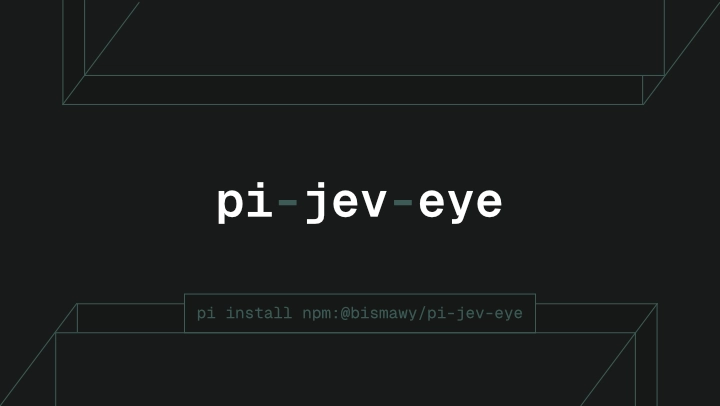

# Jev Eye

Ultra-lean supervisor. Three-layer guardrails. Semantic gate for Pi.

[](https://pi.dev/packages/@bismawy/pi-jev-eye)
[](https://www.npmjs.com/package/@bismawy/pi-jev-eye)
[](https://github.com/bismawy/pi-jev-eye)



## Overview

pi-jev-eye is a zero-dependency supervisor for [pi](https://github.com/earendil-works/pi-coding-agent). It blocks destructive commands and credential leaks locally, checks that edits run tests before completion claims, routes turns by task complexity, and evaluates diffs through [TypeSafe Jev](https://typesafe.ai/), OpenRouter, or [Cloudflare Workers AI](https://developers.cloudflare.com/workers-ai/models/clef/) (Clef) before writes hit disk.

- **Instant Regex Gate:** 0 ms, 0 token barrier blocking wipes (`rm -rf /`, `DROP DATABASE`), protected branch force-pushes, and hardcoded secrets (`sk-...`, `ghp_...`, SSH keys).
- **Done-Check Verification:** Warns when the agent claims done after editing files without running verification suites (`npm test`, `cargo test`, `pytest`).
- **Targeted Semantic Gate:** Evaluates diffs ≥ 10 lines via TypeSafe Jev, OpenRouter, or Clef (`has_slop`, `has_unfinished_todo`) to reject placeholder stubs and unfinished work.
- **Active Backend & Failover (`/jev-eye models`):** Lists every backend this session can call (TypeSafe `jev-latest`, OpenRouter `typesafe/jev-1.13`, and each Clef model such as `clef`, `clef (flash)`). Press `[Space]` to set the active backend and `[Tab]` for its fallback. The active backend answers first; the fallback runs only after a non-OK response, a rejected envelope, a timeout, or a network error, and `/jev-eye status` counts how many calls needed failover. Refs absent from the catalog read as unset so stale entries in `backends.json` cannot target missing routes.
- **Live Clef Model Discovery:** Queries Cloudflare's model-discovery route once per session and caches the list, so new `clef-*` models appear in `/jev-eye models` without a package release. If the request fails, the shipped list (`clef`, `clef-flash`) remains available.
- **Status Footer (`Eye: ● ON (…)`):** Shows the supervisor state (`● ON`, `● REVIEW`, or `○ OFF`) and the active backend suffix (`(Clef Flash)` for Clef models, or `(Jev)` for TypeSafe and OpenRouter) derived from the active backend in `backends.json`.
- **Per-Turn Model Routing (`/jev-eye routing`):** Routes routine chores (`git commit`, `push`, `status`) to a fast model and engineering tasks to a heavy model with independent thinking-level controls.
- **Jev + Clef Usage Panel (`/jev-eye usage`):** Shows Jev and Clef side by side (requests, input tokens, monthly cost), three period totals, and the Cloudflare 10,000 neurons/day free budget with its reset time and overage cost. Entries written before provider attribution appear in an explicit `Earlier` row.
- **Reviewed Turns (`jev` / `@jev` / `/eye`):** Injects a calibrated review contract with machine facts, scoring tables, and single-flight prompt alignment (`answers_request`). Both `/eye <task>` and inline `/eye` inside a prompt trigger the same path.
- **Shipped Skill (`/skill:eye-judgment`):** Bundles the calibrated judgment workflow inside the package (System One HTTP recipe, `item × dimension ≤ 32` batching, pruned state, and question-writing rules for triage, ranking, rubric scoring, A/B comparison, and probability estimation).
- **Fail-Open Reliability:** Network timeouts or offline provider APIs degrade gracefully so coding sessions never stall.
- **Menu & Account Management (`/jev-eye`):** Opens Accounts, Models, Status, Usage, and Routing inside rounded Arnative frames. On Accounts, `[Enter]` stores a key and `[R]` (pressed twice) removes one without a separate logout menu. On any screen the menu opened, `[Esc]` returns to the menu; a screen opened by subcommand cancels instead.

## Install

```bash
pi install npm:@bismawy/pi-jev-eye
```

Supply your Jev API key via `/jev-eye accounts` (TypeSafe, OpenRouter, or Cloudflare Workers AI), or export `TYPESAFE_API_KEY` / `OPENROUTER_API_KEY`. For Cloudflare Clef, export `CLOUDFLARE_ACCOUNT_ID` **and** `CLOUDFLARE_API_TOKEN` (a token alone cannot build the account-scoped route).

Stored credentials live side by side in `~/.pi/agent/pi-jev-eye/auth.json` (mode 0600) with one entry per provider, so logging in with Clef keeps any stored TypeSafe key intact. `/jev-eye accounts` removes a highlighted stored key on two presses of `[R]`. Environment variables take precedence over stored keys and are reported without being modified.

Backend selection lives separately in `~/.pi/agent/pi-jev-eye/backends.json` (`{ "primary": "cloudflare:clef-flash", "fallback": "typesafe:jev-latest" }`). Empty slots fall back to the default credential precedence. The fallback runs only when the active backend fails outright (non-OK response, rejected envelope, timeout, or network error), and `/jev-eye status` counts those failovers.

Per-session caps default to 20 gate requests and 20 routing classifications. Set `PI_JEV_EYE_MAX_REQUESTS` or `PI_JEV_EYE_MAX_ROUTING_CALLS` to a positive integer before starting Pi to change them; any other value keeps 20.

To test locally without installing:
```bash
pi -e ./extensions/index.ts
```

## Shortcuts & Commands

| Trigger | Scope | Action |
| --- | --- | --- |
| `ctrl+alt+e` | Keybinding | Cycle supervisor mode: **ON** → **REVIEW** → **OFF** |
| `ctrl+alt+u` | Keybinding | Cycle Jev folder gate: **Enable all** → **This folder** → **Disabled** |
| `/jev-eye` | Global | Interactive menu: Accounts, Models, Status, Usage, Routing |
| `/jev-eye accounts` | Setup | Authenticate with TypeSafe, OpenRouter, or Cloudflare Workers AI (Clef) against the live route (mode 0600), and remove the highlighted stored key with `[R]` (press twice) |
| `/jev-eye models` | Setup | Models screen: `[Space]` sets the **active** backend and `[Tab]` sets its **fallback** in `backends.json` |
| `/jev-eye status` | Inspect | Live state: supervisor, active backend and fallback, gate scope, rules, routing, block counts. Spend lives in `usage` |
| `/jev-eye usage` | Inspect | Spend breakdown: Jev vs Clef side by side, period totals, and the Cloudflare free-neuron budget |
| `/jev-eye routing` | Routing | Interactive TUI model router for light and heavy task slots (`routing light` / `routing heavy` focus a slot; `routing on` / `routing off` toggle it) |
| `jev` · `@jev` in prompt | Prompt | Trigger calibrated review format and task alignment check |
| `/eye <task>` | Prompt | Flat trigger: opens the reviewed contract for that turn |
| `/eye` inside a prompt | Prompt | Inline trigger (`Hai, bantu saya /eye`): pi treats text as a command only at the start of input, so the inline form reaches the review path |
| `/skill:eye-judgment <task>` | Skill | Force-inject the shipped judgment workflow: System One HTTP recipe, batching limits, and question-writing rules for triage, ranking, rubric scoring, A/B, and probability tasks |

### The shipped skill

Installing the package installs the `eye-judgment` skill alongside `extensions/`. When invoked, its body is injected as a user message specifying the request shape: one request with batched questions (`item × dimension ≤ 32`), pruned state, machine facts collected first, and the report format aligned with `REVIEW_CONTRACT`. Judgment-shaped prompts can trigger it from its description, and `/skill:eye-judgment` invokes it directly.

### Providers

| Provider | Credential | Model | Cost |
| --- | --- | --- | --- |
| TypeSafe | `$TYPESAFE_API_KEY` or `/jev-eye accounts` | `jev-latest` | Per-token, ledger-based |
| OpenRouter | `$OPENROUTER_API_KEY` or `/jev-eye accounts` | `typesafe/jev-1.13` | Reported by the provider |
| Cloudflare Workers AI | `$CLOUDFLARE_ACCOUNT_ID` + `$CLOUDFLARE_API_TOKEN`, or `/jev-eye accounts` (asks for both) | `clef-flash` (default) or `clef` | Clef: $0.24/M input; clef-flash: $0.038/M input; output free; 10,000 free neurons/day at 00:00 UTC |

Which backend answers is independent of login order: the store keeps every key you add, and `/jev-eye models` chooses the active backend and fallback. The Clef model list comes from Cloudflare's model-discovery route once per session, so new upstream models (e.g. `clef-omni`) appear without a package release.

### Why Clef

Clef is Cloudflare's decision model (`@cf/cloudflare/clef`). It answers the same typed System One questions (`noul` / `choice` / `score`) as Jev, so switching backends keeps gate logic unchanged:

- **Free for normal sessions.** Every account gets 10,000 neurons per day, reset at 00:00 UTC. `clef-flash` bills 3,455 neurons per million input tokens, keeping typical sessions inside the free allowance; `/jev-eye usage` shows the exact count and overage (`$0.011/1,000` neurons) if exceeded.
- **No output-token billing.** Clef charges input tokens only, so cost depends on the diff you send rather than reasoning length.

Authentication requires the 32-character hex account ID **plus** a Workers AI token (`Workers AI: Read`) because the route is account-scoped (`…/accounts/{ACCOUNT_ID}/ai/run/@cf/cloudflare/clef-flash`). Both values are validated and probed against the live run route before saving.

> **Notes:**
> - **pi-arnative status bar:** Shows the live mode and active backend: `Eye: ● ON (Clef Flash)` / `Eye: ● REVIEW (Jev)` / `Eye: ○ OFF (Jev)`. The suffix updates automatically from `/jev-eye models`.
> - **Portable keybindings:** `ctrl+alt+<letter>` works across legacy terminals (ESC-prefixed ctrl codes) and kitty-protocol terminals (CSI-u sequences), avoiding Ghostty (`ctrl+shift+e`, `ctrl+shift+t`), macOS (`super+shift`), and terminal shift-chord ambiguities.

### Modes

```
Ctrl+Alt+E ──► ON ──► REVIEW ──► OFF ──┐
                 ▲                     │
                 └─────────────────────┘
```

| Mode | Footer | Regex & Done-Check | Jev Semantic Gate | Review Contract | When Review Triggers |
| --- | --- | --- | --- | --- | --- |
| **ON** | `Eye: ● ON (…)` | Active | Active (diffs ≥ 10 lines) | Optional | Only when the prompt contains `jev` / `@jev` / `/eye` |
| **REVIEW** | `Eye: ● REVIEW (…)` | Active | Active (diffs ≥ 10 lines) | Injected every turn | Every prompt automatically |
| **OFF** | `Eye: ○ OFF (…)` | Disabled | Disabled | Disabled | Never |

## Architecture

<details>
<summary><b>Three-Layer Guardrails</b></summary>

```
Agent Action (tool_call / message_end)
       │
       ▼
[Layer 1: Local Regex Gate]     ──► rm -rf / force-push / secret? ──► [BLOCKED INSTANTLY] (0 ms, 0 token)
       │ (Safe)
       ▼
[Layer 2: Done-Check Tracker]   ──► Files modified but claims done without test? ──► [WARNING NOTICE] (0 token)
       │ (Passed)
       ▼
[Layer 3: Jev Semantic Gate]    ──► New code diff ≥ 10 lines? ──► [JEV SLOP EVAL] (P ≥ 0.85 blocked)
```

- **Layer 1 (`extensions/layer1.ts`):** Pre-execution regex filter. Blocks destructive bash wipes (`rm -rf /`, `rm -rf $HOME`, `git reset --hard`, `DROP DATABASE`, `mkfs`), protected branch force-pushes (`main`/`master`, while safely permitting `--force-with-lease`), and secret leaks (`sk-...`, `ghp_...`, `AIza...`, private SSH keys).
- **Layer 2:** Turn monitor. Tracks file modifications during a turn and prompts the agent if it declares completion without invoking recognized test suites (`npm test`, `pnpm test`, `bun test`, `cargo test`, `cargo check`, `pytest`, `mypy`, `ruff`, `go test`, `vitest`).
- **Layer 3:** Post-generation gate. Submits code diffs ≥ 10 lines in opt-in folders to TypeSafe Jev as a single batch request (`has_slop`, `has_unfinished_todo`, and prompt alignment `answers_request` on reviewed turns). Blocks when `p ≥ 0.85` with actionable diagnostics.

</details>

<details>
<summary><b>Model Routing</b></summary>

Run `/jev-eye routing` to open the interactive model selector:

- **Light Model:** Routine chores (`status`, `commit`, `push`, `log`, `diff`) route to the light model with **zero Jev requests**.
- **Heavy Model:** Substantive coding and review tasks route to the heavy model.
- **Independent Thinking:** Each slot walks its own range (light: `off` → `minimal` → `low` → `medium` → `high`; heavy: `low` → `medium` → `high` → `xhigh` → `max`), so chores can stay fast while reviews run deep.
- **Context Guard:** Prevents overflow by staying on the heavy or current model if context exceeds 30k tokens or 50% window.
- **Same backend chain as the gate:** Routing classification and the write gate both call the active backend from `/jev-eye models`, then its fallback, so a stalled provider delays one turn rather than dropping classification.
- **Theme-Adaptive TUI:** Automatically matches active Pi theme tokens (`accent`, `muted`, `dim`, `success`).

| Key | Action |
| --- | --- |
| `type` | Filter models by id, provider, or display name |
| `↑` `↓` | Navigate list |
| `space` | Assign highlighted model to **Light** slot; press it again on the same row to cycle that slot's thinking level |
| `ctrl+h` · `ctrl+q` | Assign highlighted model to **Heavy** slot; press it again on the same row to cycle that slot's thinking level |
| `ctrl+r` | Toggle routing on / off |
| `enter` | Save configuration (`~/.pi/agent/pi-jev-eye/routing.json`) |
| `esc` | Cancel and exit without changes |

</details>

<details>
<summary><b>Usage & Telemetry Ledger</b></summary>

Tracks detailed usage in `~/.pi/agent/pi-jev-eye/usage.json` (plus legacy migration from `~/.pi/agent/pi-typesafe/usage.json`):

- Each day keeps the overall counters and an optional per-provider map, so `/jev-eye usage` can split Jev (TypeSafe/OpenRouter) from Clef without reading a second file. Entries written before this field read as 0 and are never invented.
- Cloudflare is billed in **neurons**: the panel shows today's neuron count against the 10,000/day free allowance (reset 00:00 UTC) and overage at `$0.011/1,000` neurons. Output tokens are not billed; per-model input rates are `clef` 21,818, `clef-flash` 3,455, and `clef-omni` 13,636 neurons/M input.

- **Daily & Monthly Telemetry:** Request counts (success/fail), token counters (input/output), and estimated dollar cost.
- **Provider Balance:** Live credit lookup for OpenRouter accounts (`/api/v1/key`).
- **Interception Stats:** Cumulative counts of Layer 1 regex blocks, Layer 2 done-check reminders, Layer 3 slop rejections, and reviewed turns.

</details>

<details>
<summary><b>Development</b></summary>

```bash
npm test             # Pure logic, frame maths, and the failover path (offline, no dependencies)
npm run render-check # Renders the real screens and asserts the frame width, colour and legends
npm run dev          # Test extension locally in active session
```

`npm run render-check` drives `/jev-eye` through a fake TUI and asserts what a screenshot would show:
every line exactly on the terminal width, a coloured frame, a masked key, one divider column across every
list, and no advertised key lost to truncation. The legend check reads `KEY_SETS`, so a key that drifts
from the handler fails the command instead of lying in the footer. It needs the peer dependencies
resolvable, so run it where pi provides them, or link a checkout that has them:
`ln -s ../pi-arnative/node_modules node_modules`.

### Modules

`extensions/` is layered leaf-first; each file imports only layers above it. `npm test` covers `layer1.ts`, `layer2.ts`, `gate.ts`, `review.ts`, and `providers.ts` (with a stubbed `fetch`), while `npm run render-check` covers every TUI screen and the `/eye` handler.

| File | Owns |
| --- | --- |
| `layer1.ts` | Pure math: box chrome, regex gates, ledger folds (no pi import) |
| `pmr.ts` | Session state leaf touched by every layer |
| `review.ts` | Reviewed-turn trigger and injected report contract (no pi import) |
| `layer2.ts` | Done-check turn tracker over `pmr.ts` state |
| `core.ts` | Providers, model catalog, on-disk paths, credential/backend stores, and auth chain resolution |
| `consent.ts` | Per-folder gate consent store and cycle helper |
| `ledger.ts` | Usage ledger persistence (`usage.json`), per-provider billing, and OpenRouter balance lookup |
| `providers.ts` | Live credential probe (`probeJev`), failover walker (`withBackends`), and shared decision POST (`postDecision`) |
| `routing.ts` | Per-turn light/heavy model router (`routing.json`), regex chore shortcut, and weight classifier |
| `gate.ts` | Layer 3 semantic write gate, machine code facts, and diff context extraction |
| `supervisor.ts` | `KEY_SETS`, mode cycle, subcommand metadata, and status-bar indicator |
| `ui.ts` | Arnative rounded-box chrome, custom dialogs, and picker/panel components |
| `flows.ts` | Interactive login and stored credential removal flows |
| `panels.ts` | `/jev-eye status` and `usage` panel builders and screens |
| `commands.ts` | `/jev-eye` menu loop, argument dispatch, and flat `/eye <task>` trigger |
| `index.ts` | Event wiring only: routing, consent, Layers 1-2, shortcuts |

</details>

## License

Distributed under the **MIT** license.

## Author

[Bisma](https://github.com/bismawy)
